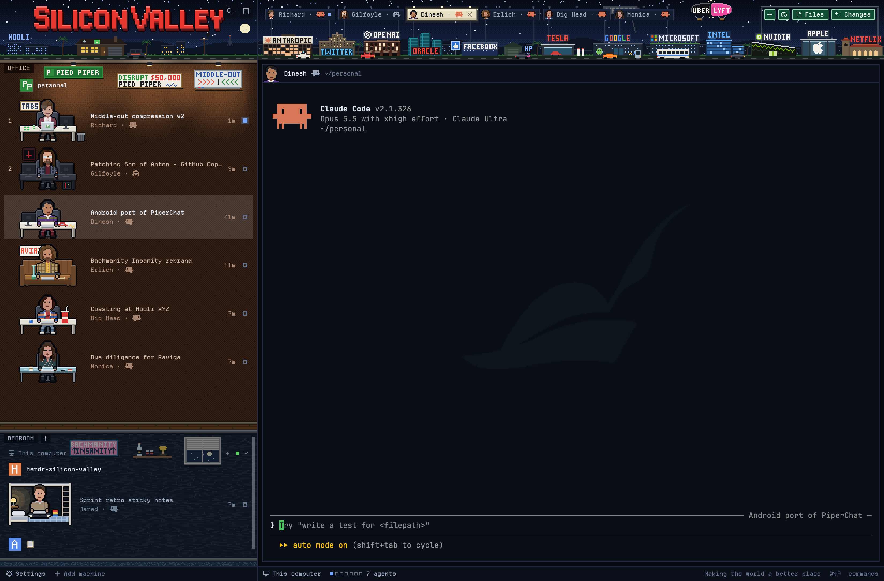

# Silicon Valley

Herdr as HBO's Silicon Valley, in pixel art, at night, after the show's opening titles. Across the top, the red title and then a skyline of the valley's companies from San Francisco down to Los Gatos, with your tabs as billboards over it and the buttons as green freeway signs. The sidebar is the Hacker Hostel: every agent is played by a character from the show, seated at their own desk in the Office when it has a priority, cross-legged on a bunk in the Bedroom when it doesn't, posed by what it is doing. Pied Piper's hat sits faintly behind the terminals. Dark only.

## What you see

The window has no title bar (`titlebar: "none"`, traffic lights at `[12, 16]`), the theme `pied-piper` and 1px `border` dividers. Theme: background `#0a0e17`, canvas `#05080f`, chrome `#0b101b`, border `#1e2a44`, text `#e2e8f2` / muted `#9aa7bd` / dim `#64718a`, accent Pied Piper green `#4fc45f`; working `#76a8ff`, blocked `#f2705e`, done `#a6bd91`, idle `#64718a`. The layout's own text is Departure Mono at 11px (bundled); terminals keep the person's font, with padding `[14, 12]`.

Left, the sidebar, 480px (it folds to a 44px rail):

- **Title**, 112px: one picture (`world/brand.png`). "SILICON VALLEY" in the show's red, its S and V a little taller than the rest, over the valley at night: Hooli's campus, houses, palms, a moon. Search and fold buttons sit in its corner.
- **Office**, the spaces with a priority, and **Bedroom**, all the others, sharing the height between them (each at least 90px). Each room is one wall papered edge to edge (`world/wall-*.png`), 8px of trim along its top and a floor strip (`world/floor-*.png`) at its bottom, with its name on a dark plate at the top left. The Office is terracotta plaster under a beam, dark but for three track lights washing the top of the wall, where the Pied Piper banner, the Disrupt $50,000 check and the middle-out whiteboard hang. The Bedroom is Richard's room: blue-gray paint, white trim, a blue shag carpet, a Bachmanity Insanity poster, a shelf and a window, darker still; its plate has a "+" for a new space. Room text takes the wall's own quiet colors: Office `#d2b6a4` / `#a98672`, Bedroom `#9eabbd` / `#6d7b90`.
- In both rooms, a **space** is a 28px row: its sign (the first letter of its name on one of six colors, or Pied Piper's logo for the home folder's space) and its name, plus the branch and ahead/behind when its repo isn't plain. Under it, each **agent** is an 82px row: a 124×80 picture of its character at a desk (Office) or on a bunk (Bedroom), starting at the sign's left edge, then its title (the tab's name, or what the terminal says it is doing), then "Name · mark" (the character, and the agent's tool as a small pixel mark), how long ago, and its status mark at the right. Nine characters have one thing of theirs on the wall to the left of their head. In the Office each row carries its priority number on the left, and rows start 21px further in to leave room for it.
- **Footer**, 28px, plain: Settings and + Add machine.

Right, the work area:

- **Tabs**, 112px: the night sky and the skyline (`world/band-back.png` behind, `world/band-front.png` in front), its companies in the order of the drive from San Francisco to Los Gatos, the show's own made-up ones last. Each tab of the shown space is a billboard on two posts, standing behind the front row of buildings: the face of the character playing its agent, their name and the tool's mark (Claude Code's in its own coral, `#d97757`; elsewhere marks are tinted like the text around them). Billboards are dark (`#141d30`), and the shown tab's is lit (`#e6dfc4`, with a warm glow). Past them, a gantry of green freeway signs (`#0f4d35`, a `#b9d6c4` line inside the edge): new tab, new Copilot tab, Files and Changes, each panel's sign yellow (`#e3c04a`) while it's open.
- **Panes**, 8px apart and from the edges: square, a 1px `border` frame, focused or not. Each has a 33px header: the character's face, the tool's mark, the folder, the status, and split, zoom and close. Behind the terminal, `world/watermark.png`: Pied Piper's hat and feather in the theme's green, centered by eye under the header; with `terminal_opacity` 0.7 it shows at about a tenth of its strength.
- **Files** and **Changes** (Herdr's own) in a hidden 368px panel to the right.
- **Status bar**, 28px, plain: the machine and branch, one light per agent, how many there are and who needs you; at the right, "Making the world a better place" and the command palette's key.

## How it behaves

- **Statuses.** Working: a filled square in working blue with a slow, faint halo (opacity 0 to 0.3 over 7 seconds); the character's laptop is lit. Blocked: a "NEEDS YOU" chip in blocked red; the character raises a hand and a bubble appears to the right of their head. Done: a filled square in done green; the character cheers, with a bubble. Idle: an outlined square; at a desk the laptop is shut, on a bunk it is open but dark. Nothing else moves: the characters are still poses.
- **Casting.** An agent's character comes from the model it runs, in tiers. Fable, Opus and GPT Astra: Richard, Gilfoyle, Dinesh. Sol: Jian-Yang, Carla. Any other model: Erlich, Big Head. A full tier spills into the tiers below it, then into the other ten (Jared, Monica, Gavin, Russ, Laurie, Peter Gregory, Jack Barker, Fiona, Denpok, Ron, in that order); a model that can't be read goes straight to those ten. A character is chosen when a session starts, or when its model changes group before the session's first message. From the first message it stays until the next session in that terminal.
- **Priorities.** Right-click a space or an agent for its menu (Herdr's items plus Priority). Priority opens a 1–5 flyout. Spaces and agents share one list, each number held once: picking a taken number moves the holder, and the run of taken numbers behind it, one place on; one pushed past 5 loses its number. An agent's number is freed when the agent exits. A space with a number, its own or one of its agents', is in the Office, ordered by its best number; the rest are in the Bedroom, A–Z, grouped by machine when there is more than one. With no priorities, the Office says "Right-click a space or agent to prioritize it."
- **Tab order** follows priority in every space: tabs holding a numbered agent come first, by number; the rest keep their order and can be dragged among themselves. Cmd+1–9 follow it.
- **Clicks.** A row focuses its pane. A tab's billboard selects it; double-click renames, right-click opens Herdr's tab menu. The gantry's + opens the new-tab menu. Double-clicking the line between the two rooms makes the Bedroom as tall as its rows, once. Hover a tool's mark for its name. Rows scroll over the wall and what hangs on it, under the trim; the wall stays put.
- **Subagents** that Copilot, Claude Code and Codex run inside themselves are listed under their agent, joined by a line from the desk's left leg (a bunk's left post); finished ones fold into one "N finished" row that opens on click.
- **Notifications** are drawn by the layout's own toast, with the character's face.

## Built from

- **Layout** (`layouts/pied-piper.json`): a root `row` (`background: canvas`, `theme: pied-piper`, `toast: pied-piper`, `terminal_opacity: 0.7`, `preview: layouts/pied-piper.png`) of two columns. The `sidebar` column (480px, min 44, `chrome`) holds `brand` (112px, `window_drag`), a `sidebar-lists` column of `priority` and `inactive` (weight 1 each, min 90) and `sidebar-footer` (28px). The `work` column holds `tabs` (112px, `window_drag`), `work-body` (a row, padding 8, gap 8: `main`, the active tab's panes with a 33px top header, the watermark as `background` with `fit: cover`, `border` and `focus` both 1px `border`, radius 0, gap 8, `lone: true`; and the hidden `panel` column, 368px, 280–900, a stack of `files` and `changes`), then `status` (28px).
- **`mods/pied-piper/`**: one mod in roles, chosen in `main.js` by `props.role`: `brand` and `footer` (`chrome.js`), `spaces` with `list: "priority"` or `"inactive"` (`spaces.js`), `tabs` (`tabs.js`), `pane` (`pane.js`), `status` (`status.js`), and the toast (`toast.js`, picked when the props carry a notification). `ui.js` holds the font, colors, icons and status marks; `cast.js` the 17 characters and the casting, kept in shared `"pied-piper.cast"`; `order.js` the tab order (plain functions, testable with node).
- **`mods/pied-piper-menu/`**: a clone of Herdr's `menu` 0.1.15 with the Priority items, opened by `spaces.js` as a popup; priorities are shared state `"pied-piper.priority"`: `{ spaces: [{ id, machine, n }], agents: [{ pane, machine, n }] }`. Space colors are shared `"space.colors"`.
- **Herdr's own mods used:** `files`, `changes`, `menu` (tab menu), `new-menu`, `picker` (search), `machine-add`, and icons from `workspace-chrome` and `tabs`.
- **`herdr` module:** `spaces`, `machines`, `panes`, `agents`, `terminals`, `focused`, `knownAgents`, `notify`, `run`, `openOverlay`, `exec`, `hc`, `theme`, `props`, `shared` / `setShared`, `setAgentOrder`, `watchFolder`, `home`. Commands: `pane.focus`, `tab.select`, `tab.new`, `tab.rename`, `tab.close`, `tab.move`, `space.new`, `terminal.peek`, `layout.show` / `layout.hide` / `layout.select`, `mod.open`, `app.settings`, `app.palette`, `window.minimize` / `window.maximize` / `window.close`.
- **Programs it runs:** `python3` with a script in `spaces.js` that reads each agent's own records to find its model and subagents (Copilot: `~/.copilot/logs` and `~/.copilot/session-state`; Claude Code: `~/.claude` and any `~/.claude-*`; Codex: `$CODEX_HOME` or `~/.codex`), only reading; `hc get <terminal> --json` for an agent's process; `git` for each space's branch; on macOS, `defaults read -g com.apple.mouse.doubleClickThreshold`. `claude-model.sh` is an optional Claude Code status-line script that records each session's model in `~/.local/state/herdr-pied-piper/`; it isn't turned on.
- **Art:** every picture is drawn by `art/generate.py` (Python with Pillow): the characters (`art/heads.py`, one small drawing each; `art/cast.py`, one body rig with each person's build and clothes) at desks (`seats/`) and on bunks (`beds/`) in four poses each, their faces (`cast/`), the walls, title, skyline and watermark (`world/`), the icons and tool marks (`icons/`), where each piece of furniture stands (`seats/legs.js`, `beds/legs.js`) and the layout's preview. `sounds/generate.py` (plain Python) writes `needs-you.wav` and `finished.wav`, the opening bars of the show's title music played on a synth.

## Watch out

- Pixel art is drawn small, saved at 4x and shown at 2x, so every art pixel is a whole number of screen pixels; an image Herdr has to enlarge comes out smoothed.
- A pane's `background` image is cached by file name: give a changed watermark a new name.
- A picture laid over clickable things can take their clicks: the skyline's front layer stays below the billboards' faces.
- In gpui-kit, `.line_height(14)` is a multiplier; write `"14px"`.
- A module-level name that matches an imported one silently wins over the import, with no error.
- `herdr-app check` renders with no props: to check a role, check a copy with the role forced.
- Without `python3` on a machine, its agents can't be read: no subagents, and every agent is cast from the overflow.
- The new Copilot tab sign starts Copilot as `knownAgents()` reports it; where Copilot isn't installed, a click shows an error toast instead.
- Sounds aren't part of a layout: they are the person's `settings.json` `sounds`, and they then play in every layout. The WAVs were made for macOS.
- 17 characters: past them, an agent shares its tier's least-played one. Priorities run 1–5.

## Done when

- `herdr-app check` passes for `mods/pied-piper` with each role forced (brand, footer, spaces with each list, tabs, pane, status, toast) and for `mods/pied-piper-menu`.
- Switching to the layout shows the title and skyline across the top, a billboard per tab with the lit one for the shown tab, four freeway signs, the Office and Bedroom walls, and the status bar.
- Right-clicking an agent and picking Priority 1 moves its space into the Office with a 1 beside the row, and its tab to the front.
- A new Opus or Fable agent is played by Richard, Gilfoyle or Dinesh while one is free, and keeps that character after its first message.
- An agent waiting for an answer raises a hand with a bubble to the right of its head and shows NEEDS YOU; one that finishes cheers.
- Double-clicking between the two rooms fits the Bedroom to its rows.
- The hat shows faintly behind every terminal.
